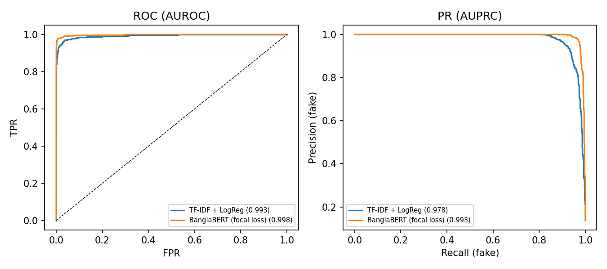
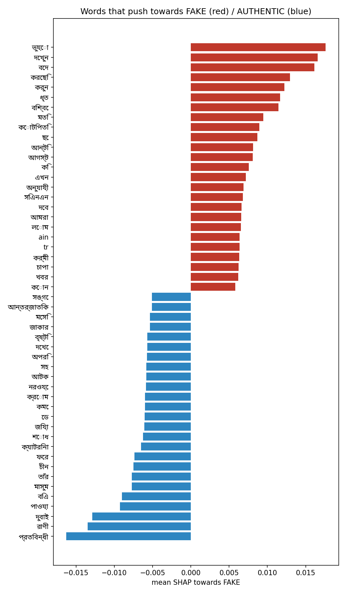

# Results — Bangla Fake News Detection + Explainability

Data: **BanFakeNews** (Hossain et al., LREC 2020) **+ BanFakeNews-2.0** (Shibu et al., 2025), merged and
**deduplicated across both** (55,038 unique articles, 13.7% fake). Articles that also appear in the
BanFakeNews-2.0 independent test set (998) were removed from training. Split stratified by label × source.
Decision threshold tuned on validation for fake-F1: **0.28**.

## Data
| split | origin | articles | fake |
|---|---|---|---|
| test | v1 | 96 | 4 |
| test | v1+v2 | 4784 | 125 |
| test | v2 | 627 | 626 |
| train | v1 | 761 | 27 |
| train | v1+v2 | 38260 | 992 |
| train | v2 | 5006 | 5006 |
| val | v1 | 95 | 3 |
| val | v1+v2 | 4783 | 124 |
| val | v2 | 626 | 626 |

## Results
| model | eval_set | n | n_fake | fake_f1 | macro_f1 | fake_precision | fake_recall | auroc | auprc |
|---|---|---|---|---|---|---|---|---|---|
| TF-IDF + LogReg (balanced) | pooled test | 5507 | 755 | 0.932 | 0.961 | 0.962 | 0.905 | 0.993 | 0.978 |
| TF-IDF + LogReg (balanced) | independent test (BanFakeNews-2.0) | 998 | 460 | 0.940 | 0.944 | 0.928 | 0.952 | 0.988 | 0.989 |
| BanglaBERT (focal loss) | pooled test | 5507 | 755 | 0.972 | 0.984 | 0.976 | 0.968 | 0.998 | 0.993 |
| BanglaBERT (focal loss) | independent test (BanFakeNews-2.0) | 998 | 460 | 0.831 | 0.812 | 0.715 | 0.991 | 0.990 | 0.991 |

## By source (pooled test) — does the model only learn one dataset's style?
| origin | n | n_fake | fake_f1 | macro_f1 | fake_precision | fake_recall | auroc | auprc |
|---|---|---|---|---|---|---|---|---|
| v1 | 96 | 4 | 0.889 | 0.942 | 0.800 | 1.000 | 1.000 | 1.000 |
| v1+v2 | 4784 | 125 | 0.877 | 0.937 | 0.867 | 0.888 | 0.992 | 0.937 |
| v2 | 627 | 626 | 0.992 | 0.579 | 1.000 | 0.984 | 0.995 | 1.000 |

## Which kinds of fake news are caught? (pooled test)
BanFakeNews-2.0 marks fake articles with sub-types 0/1/2 (3 = authentic); by inspection type0 looks like satire,
type1 like fabricated news and type2 like clickbait/misleading. `authentic` row = false-alarm rate.

| subtype | n | flagged_as_fake |
|---|---|---|
| authentic | 4752 | 0.004 |
| fake | 129 | 0.891 |
| v2_type0 | 113 | 0.982 |
| v2_type1 | 186 | 0.989 |
| v2_type2 | 327 | 0.982 |

## By news category (pooled test, ≥50 articles)
| category | n | n_fake | fake_f1 | macro_f1 | fake_precision | fake_recall | auroc | auprc |
|---|---|---|---|---|---|---|---|---|
| Crime | 130 | 5 | 0.889 | 0.942 | 1.000 | 0.800 | 0.958 | 0.831 |
| Education | 111 | 2 | 1.000 | 1.000 | 1.000 | 1.000 | 1.000 | 1.000 |
| Entertainment | 267 | 10 | 0.800 | 0.896 | 0.800 | 0.800 | 0.993 | 0.919 |
| International | 700 | 8 | 0.700 | 0.848 | 0.583 | 0.875 | 0.997 | 0.861 |
| Lifestyle | 88 | 9 | 0.824 | 0.902 | 0.875 | 0.778 | 0.990 | 0.924 |
| Miscellaneous | 270 | 61 | 0.975 | 0.984 | 0.983 | 0.967 | 0.995 | 0.991 |
| National | 1812 | 14 | 0.750 | 0.874 | 0.667 | 0.857 | 0.996 | 0.872 |
| Politics | 308 | 11 | 1.000 | 1.000 | 1.000 | 1.000 | 1.000 | 1.000 |
| Sports | 659 | 5 | 0.667 | 0.832 | 0.750 | 0.600 | 0.996 | 0.823 |
| Technology | 84 | 4 | 0.571 | 0.776 | 0.667 | 0.500 | 0.853 | 0.586 |
| unknown | 627 | 626 | 0.992 | 0.579 | 1.000 | 0.984 | 0.995 | 1.000 |

## Why does it say "fake"? (SHAP)
Global view over the explained test articles (mean SHAP value per word):

Per-article highlights (red = towards FAKE): **[shap_examples.html](shap_examples.html)**

| token | mean_shap_to_fake | count |
|---|---|---|
| ভুয়ো | 0.018 | 7 |
| দেখুন | 0.017 | 4 |
| বেদ | 0.016 | 3 |
| করেছি | 0.013 | 3 |
| করুন | 0.012 | 4 |
| ধৃত | 0.012 | 3 |
| বিশ্বে | 0.011 | 3 |
| মতি | 0.009 | 4 |
| কোটিপতি | 0.009 | 3 |
| ছে | 0.009 | 5 |
| আন্টি | 0.008 | 4 |
| আগস্ট | 0.008 | 5 |
| কি | 0.008 | 9 |
| এখন | 0.007 | 3 |
| অনুযায়ী | 0.007 | 5 |

---
Runtime 7.6 min · imbalance handled with `focal` loss.
